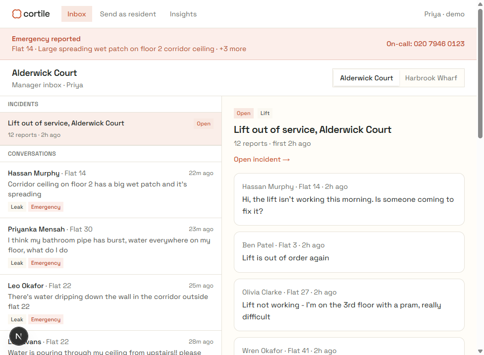

# Incidents for Cortile

Prototype property-manager inbox that triages resident messages, groups the same building problem into one **incident**, and sends one **cited, manager-approved** update to everyone affected.



## Architecture

Modular monolith — one Next.js App Router app. The AI pipeline lives in `src/lib/pipeline/` with **no UI imports**, so it could later move behind a queue.

```
Resident message
  → emergency keyword check (code, before AI)
  → Claude triage (category / urgency / summary) + Voyage embed
  → similarity + same-problem check → attach or create incident
  → draft from building docs only (RAG) → verify citations
  → manager edits → approve → deliveries (no real email/SMS)
```

| Layer | Tech |
| --- | --- |
| App | Next.js (App Router) + TypeScript strict + Tailwind |
| DB | Supabase Postgres + pgvector + Realtime |
| Models | Anthropic Claude (`CLAUDE_FAST_MODEL`, `CLAUDE_DRAFT_MODEL`) |
| Embeddings | Voyage AI `voyage-3.5-lite` (1024-d) via `src/lib/ai/embed.ts` |
| Validation | Zod on every model output |

Fake data only: **Alderwick Court** (Priya) and **Harbrook Wharf**.

## Setup

1. **Supabase** — create a project. In the SQL editor, run all of `supabase/schema.sql`.
2. **API keys** — [Anthropic](https://console.anthropic.com) and [Voyage AI](https://www.voyageai.com) (free tier works; ~3 RPM without a payment method).
3. **Env**
   ```bash
   cp .env.example .env.local
   ```
   Fill `NEXT_PUBLIC_SUPABASE_URL`, `NEXT_PUBLIC_SUPABASE_ANON_KEY`, `SUPABASE_SERVICE_ROLE_KEY`, `ANTHROPIC_API_KEY`, `VOYAGE_API_KEY`.
4. **Install & seed**
   ```bash
   npm install
   npx tsx scripts/seed.ts
   ```
   Expect: 2 buildings, 36 messages (`status=new`), 8 documents, ~41 embedded chunks.
5. **Dev**
   ```bash
   npm run dev
   ```
   Open [http://localhost:3000/inbox](http://localhost:3000/inbox).

Optional — triage + group all seeded messages in time order (uses Anthropic + Voyage):

```bash
npx tsx scripts/seed.ts --process --fresh-times
```

To process existing `new`/`untriaged` rows without reseeding:

```bash
npm run process
# or one building:
npm run process -- --building alderwick-court
```

## Before a demo

Reseed with fresh timestamps and run the full pipeline so lift/leak messages still fall inside the 24h grouping window:

```bash
# On Voyage free tier (no payment method), set in .env.local:
# VOYAGE_MIN_INTERVAL_MS=21000

npx tsx scripts/seed.ts --process --fresh-times
# equivalent: npm run seed -- --process --fresh-times
```

Expect Alderwick Court to show a lift incident with most lift reports grouped, water-ingress emergencies triaged, and Harbrook Wharf messages triaged.

## Demo script

1. From `/resident`, send **3+ lift** messages for Alderwick Court (different flats) → chips appear → incident forms around the 3rd.
2. Open the incident → **Draft update** → cited draft (e.g. Lift maintenance contract, Response times) → edit → **Approve & send**.
3. Send `water is pouring through my ceiling` → red emergency banner + on-call number.
4. Send `Can I install an EV charger in my space?` → **Suggest reply** → No source found → `/insights`.
5. On an incident report → **Move out of incident** → correction counted on Insights.

## Tuning

In `.env.local`:

| Variable | Default | Notes |
| --- | --- | --- |
| `SIMILARITY_THRESHOLD` | `0.80` | Lower if lift messages won't group |
| `DOC_MATCH_THRESHOLD` | `0.45` | Document retrieval for drafts |
| `GROUPING_WINDOW_HOURS` | `24` | Only recent same-building messages group |
| `VOYAGE_MIN_INTERVAL_MS` | `0` | Set `21000` on Voyage free tier without a payment method |

## Deploy (Vercel)

```bash
npx vercel
```

Add the same env vars in the Vercel project settings (including `SUPABASE_SERVICE_ROLE_KEY` — server only). Point the production URL at your Supabase project; Realtime needs the anon key + tables in `supabase_realtime`.

### Public demo safety

`POST /api/messages` is limited to 10 requests/minute per IP; draft and suggest routes to 5/minute. For a shareable read-only link that cannot spend Anthropic/Voyage credit, set:

```bash
DEMO_READ_ONLY=true
```

Mutating API routes then return `403` with `{ "error": "Demo is read-only" }`.

## Project layout

```
src/app/           inbox, resident, incidents, insights, API routes
src/lib/pipeline/  emergency → triage → group → draft → verify
src/lib/ai/        prompts, schemas, Claude + Voyage clients
supabase/          schema.sql
data/              seed buildings, messages, documents
scripts/seed.ts    load /data + embed chunks
```

Full build plan: **BUILD_BRIEF.md**. Cursor rules: `.cursor/rules/project.mdc`.
